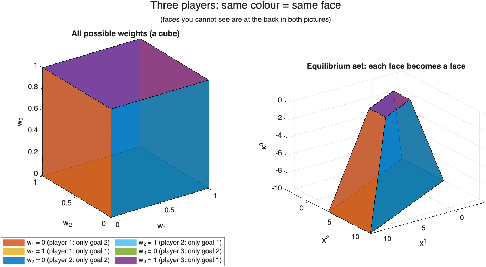
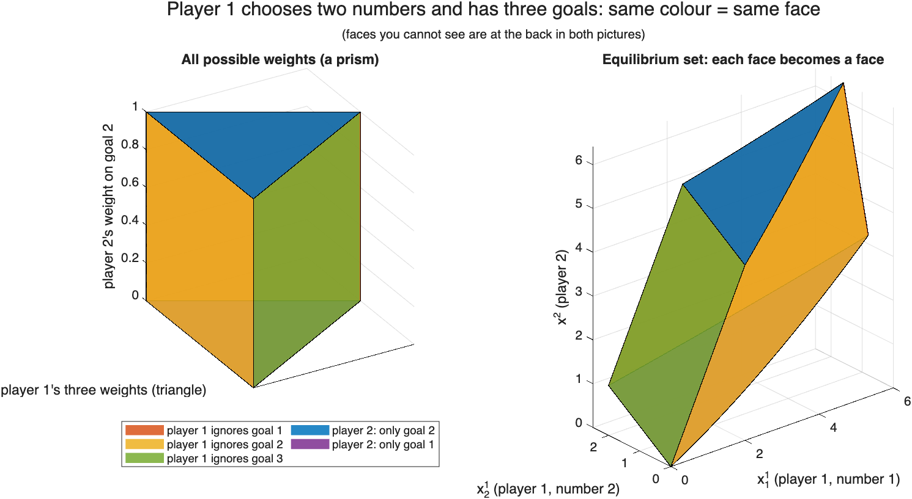
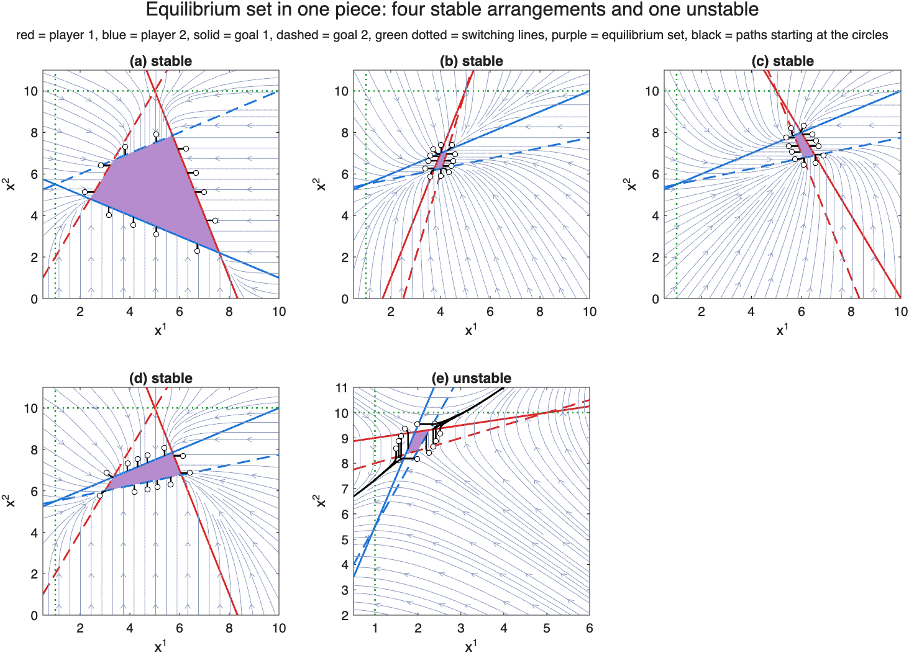
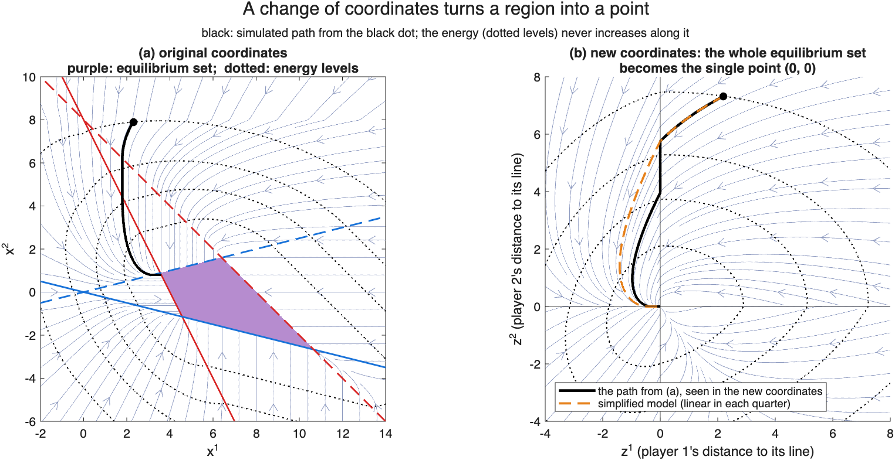
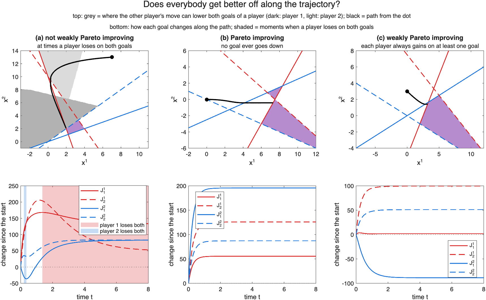
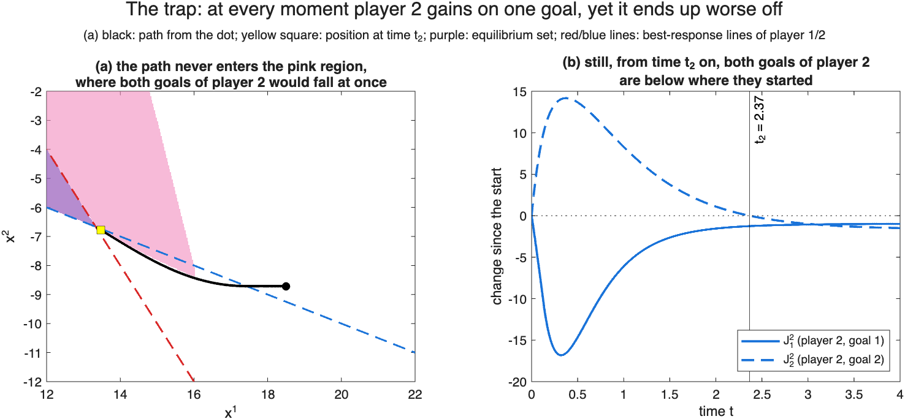
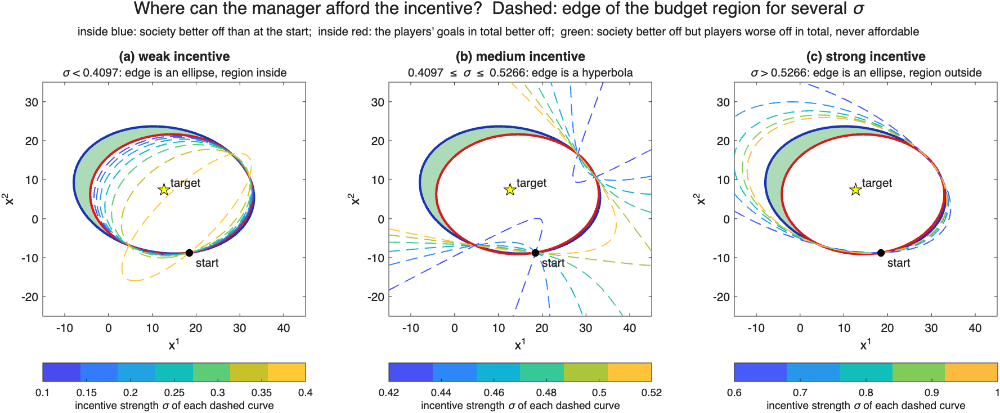
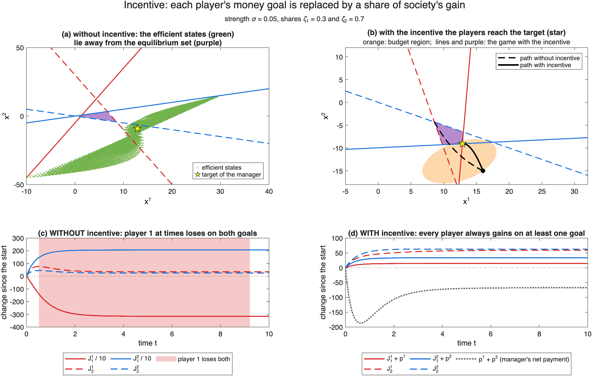

# A beginner's tour

This guide explains the ideas behind the scripts with pictures and as little
mathematics as possible. Each section ends with the script to run and the
paper where the idea comes from.

1. [The setting](#1-the-setting)
2. [What does the equilibrium region look like?](#2-what-does-the-equilibrium-region-look-like)
3. [Do the players settle down?](#3-do-the-players-settle-down)
4. [Does everybody get better off along the way?](#4-does-everybody-get-better-off-along-the-way)
5. [Can a manager help, without spending money?](#5-can-a-manager-help-without-spending-money)

---

## 1. The setting

- There are a few **players** (mostly two). Player *i* chooses a number xⁱ,
  for example how much a firm produces.
- Each player has **two goals** (payoffs), for example profit and
  environmental score. We write J¹₁, J¹₂ for the two payoffs of player 1, and
  J²₁, J²₂ for those of player 2.
- Every payoff depends on what **both** players choose, and each payoff is a
  simple quadratic ("hill-shaped") function:

  ```math
  J^i_j(x) = \frac{1}{2}\, x^\top A^{ij} x + (b^{ij})^\top x + c^{ij}
  ```

  In the code, a game is a struct `G` with `G.A{i,j}`, `G.b{i,j}` and
  `G.c(i,j)` holding these numbers.
- **Best response.** If the other player's choice is fixed, each payoff has
  one best choice for player *i*. Drawing these best choices for every
  possible choice of the other player gives a straight line, the
  **best-response line** of that payoff. With 2 players and 2 payoffs each,
  there are 4 such lines.
- **Equilibrium.** A state is an equilibrium if **no player can improve both
  of its goals at once** by changing only its own choice. Because players do
  not rank their goals, many states qualify: the equilibria form a whole
  **region**, the *equilibrium set*.

**Colours used in all figures:** player 1 red, player 2 blue; goal 1 solid
line, goal 2 dashed line; equilibrium set purple; simulated paths black,
starting at a dot or circle. Axes x¹ and x² are the choices of player 1 and
player 2.

---

## 2. What does the equilibrium region look like?

**The trick: weights.** Suppose each player decided how much it cares about
each goal, say 70% profit and 30% environment. Then it would have just one
number to maximize, and the game would have one ordinary equilibrium. Every
choice of weights gives one such point. **Collecting these points for all
possible weights gives exactly the equilibrium region.**

In the production–pollution example below, the square on the left holds all
weight choices and the region on the right holds the equilibria. A dot on
the right has the same colour as the weights on the left that produce it.
The four black corners are the cases where each firm cares about one goal
only. The script also checks the region a second, independent way: a state
is an equilibrium when, for each firm, moving can only raise one goal while
lowering the other.


**What we learn.**
- **The determinant test.** Each best-response line can be written as
  a·x¹ + b·x² = c. Pick one goal per player and put the numbers (a, b) of
  their two lines into the rows of a 2×2 matrix. With 2 goals per player
  there are four such matrices. If all four determinants have the same sign, the region is
  **bounded and in one piece**.
- If, in addition, a player's two goals never peak at the same state inside
  the region, the region is a **faithful copy of the space of weights**:
  different weights give different equilibria, and the edges and faces match.
  With three players, write wᵢ for player *i*'s weight on its goal 1. The
  weights form a cube, and the equilibrium set is a deformed cube: each face
  of the cube (for example w₁ = 0, "player 1 cares only about goal 2")
  becomes one face of the set. Both pictures show the same three faces:



The same holds when player 1 chooses two numbers (x¹₁, x¹₂) and has three
goals. Its three weights then form a triangle, the weights of both players
together form a prism, and the equilibrium set has the prism's 5 faces:



**Run:** `equilibrium_region`, `equilibrium_three_players`,
`equilibrium_vector_states`.
**Paper:** [ACC 2024](https://doi.org/10.23919/ACC60939.2024.10644643)

---

## 3. Do the players settle down?

**How the players move.** Players do not plan ahead; they react to the
current state:
- if moving can raise **both** of its goals, a player moves in that
  direction, following the goal whose best-response line is **closer**;
- otherwise (any move would hurt one goal) it **stays put**.

The switch between "follow goal 1" and "follow goal 2" happens on a green
dotted line in the figures. Between the lines the motion is simple (linear),
so the paths can be analysed piece by piece.

**What we learn.** The answer depends only on the four determinants of the
test in section 2:
- All four determinants **positive**: the region is bounded and **stable**.
  Players who start close to it are drawn into it.
- All four **negative**: the region is bounded but **unstable**. Players
  who start close to it drift away.
- **Mixed** signs: the region is **unbounded**.

The four lines can be arranged in five essentially different ways; four are
stable and one is unstable. Each panel below first predicts the answer from
the determinants and then simulates short paths that start at the small
circles next to the region. In (a)–(d) the paths run into the purple region;
in (e) some run away:



The same rule holds when the region consists of two pieces touching at a
point (`stability_two_pieces.png`), and mixed signs give an unbounded region
(`stability_unbounded.png`).

**A shortcut with an "energy" function.** Checking the regions one by one is
long. A change of coordinates helps: measure each player's distance to the
best-response line it is following (z¹ and z² below), and use 0 if it is not
moving. In these new coordinates the whole equilibrium region **collapses to
a single point**, the origin. Stability of a region then becomes stability
of a point. That can be proved with a Lyapunov function, a kind of energy
that never increases along the paths; the computer finds it by solving a
small convex problem. In the figure, the dotted curves are levels of this
energy, and the black path crosses them only inwards. In (b), the orange
dashed path is a simplified model that is linear in each quarter of the
plane; it also reaches the origin:



**Run:** `stability_cases`, `stability_lyapunov`.
**Papers:** [IFAC 2023](https://doi.org/10.1016/j.ifacol.2023.10.1395),
[CDC 2023](https://doi.org/10.1109/CDC49753.2023.10384265), and ECC
(coordinate change).

---

## 4. Does everybody get better off along the way?

Two ways to say "better off" while the players move:
- **Pareto improving:** no goal of any player ever goes down.
- **Weakly Pareto improving:** at every moment, each player has **at least
  one** goal that is not going down.

**Who can hurt you?** A player only moves to improve its own goals, so its
own move never hurts itself. Only the **other** player's move can lower its
goals. So it is enough to know where the other player's move is harmless.
This depends only on the payoffs, not on how fast each player moves, so an
outside observer can compute it.

In the top row below, the grey areas are where the other player's move can
lower **both** goals of a player. The bottom row shows how much each goal
has changed since the start, with shading at the moments when a player is
actually losing on both goals. The path in (a) crosses a grey area and both
players lose at times; (b) has no grey area and no goal ever falls; in (c)
some goals fall, but each player always has one goal rising:



**The trap.** "At every moment one goal is rising" is not enough. A player's
two goals can take turns falling. Comparing a later moment with an earlier
one, **both** goals can then be lower, and the player is simply worse off,
even though it never saw both goals fall at the same time. Below, the path
never enters the pink area (where both goals of player 2 would fall at
once), yet from time t₂ (yellow square) on, both goals of player 2 are below
where they started:



**Run:** `improvement_pareto`, `improvement_trap`.
**Papers:** [CDC 2024](https://doi.org/10.1109/CDC56724.2024.10886420),
[IEEE Control Systems Letters 2024](https://doi.org/10.1109/LCSYS.2024.3522596)

---

## 5. Can a manager help, without spending money?

A manager wants the players to reach a target state that is good for society.
Society's welfare U is a weighted sum of all goals, with the manager's
priorities as weights, and the target is where U is largest. The manager can
add a tax or subsidy pⁱ, but only to the **money** goal of each player. Two
budget rules apply:

- nobody gains or loses at the start: p¹ = p² = 0 at the starting state;
- the manager never pays out net money: p¹ + p² ≤ 0 at all times.

**The design.** In the simplest version, each player's money goal is replaced
by a fixed share ζᵢ of the gain in social welfare, scaled by a strength σ:

```math
\tilde J^i_1(x) = \zeta_i\,\sigma\,\bigl(U(x) - U(x_0)\bigr) + J^i_1(x_0)
```

Each player is now paid according to how much **society** improves, so
selfish moves push towards the target. Because a player's money goal can
never go down, nobody falls into the trap.

**The budget region.** The manager's total payment p¹ + p² is zero or
negative only in part of the plane, the budget region, and the players must
stay inside it. Its border (dashed in the figure, one curve per value of σ)
is an ellipse or a hyperbola, depending on σ. The green area can never be
in the budget region: there society is better off than at the start, but
the players are worse off in total, so the manager would have to pay. This
figure uses the game of the trap example:



**Result.** In the figure below:
- (a) Without incentives, the *efficient* states (green: no player can gain
  without another losing) lie away from the equilibrium set, so selfish
  players never reach the manager's target (star).
- (b) With the incentive, the players move from the black dot to the star
  and stay inside the budget region (orange).
- (c) Without the incentive, player 1 loses on both goals for a long time
  (shaded).
- (d) With it, every player always gains on at least one goal, and the
  manager never pays out money (the grey dotted curve stays below zero).



**Run:** `incentive_budget`, `incentive_design`.
**Paper:** [IEEE Control Systems Letters 2024](https://doi.org/10.1109/LCSYS.2024.3522596)
