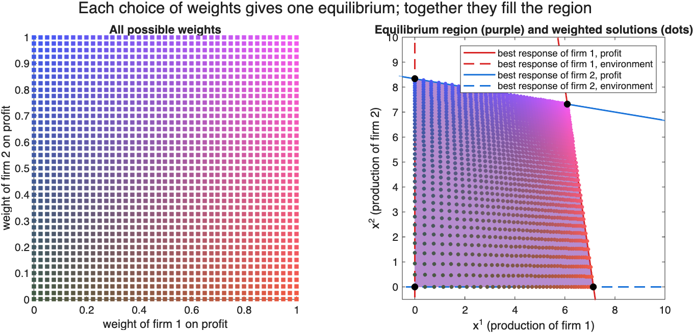

[English](README.md) | [中文](README.zh-CN.md) | **日本語**

# Vector Payoff Games（ベクトル利得ゲーム）

**各プレイヤーが同時に複数の目標を持ち**、それらを比べる決まった方法がないとき、ゲームで何が起こるかを示すシミュレーション集です。

## 考え方の要約

2つの企業が、どちらも高い利益*と*きれいな環境の両方を望んでいるとします。企業は、自分の生産量を変えるだけでは**両方**の目標を同時に良くできないとき、満足します。「満足」がもはや「ある1つの数が最大」という意味ではないので、均衡は1点ではなく、ひとまとまりの**領域**になります（上図の紫の部分）。このリポジトリでは、このようなゲームについて4つの問いを扱います。

1. 均衡領域はどのような形をしているか？
2. プレイヤーが少しずつ調整を続けると、その領域に落ち着くか？
3. その途中で、全員が良くなっていくか？
4. 管理者は、お金を使わずに税と補助金で、全員を良くすることができるか？

[GUIDE.ja.md](GUIDE.ja.md) では、それぞれの問いを図とやさしい言葉で説明しています。

## 実行方法

MATLAB（R2022a 以降、R2025b で動作確認）が必要です。ツールボックスは不要です。`stability_lyapunov.m` だけが Optimization Toolbox を使いますが、なくても実行できます。

1. MATLAB を開き、このフォルダをカレントフォルダにします。
2. `run_all` と入力して Enter を押します（約2分）。

`improvement_trap` のように、スクリプトを1つだけ実行することもできます。

## 結果の場所

- **図：** [`figures/`](figures/) フォルダにあり、実行しなくても見られます。図中の文字は英語で、各図の意味は GUIDE で日本語で説明しています。
- **チェック：** 各スクリプトは計算結果を発表済みの結果と比べて `[PASS]` / `[FAIL]` を表示し、`run_all` の最後に集計が出ます。すべて PASS になるはずです。

| 問い | スクリプト | 図 |
|---|---|---|
| 均衡領域はどのような形か？ | `equilibrium_region.m` | `equilibrium_region.png` |
| | `equilibrium_three_players.m` | `equilibrium_three_players.png` |
| | `equilibrium_vector_states.m` | `equilibrium_vector_states.png` |
| プレイヤーは落ち着くか？ | `stability_cases.m` | `stability_one_piece.png`, `stability_two_pieces.png`, `stability_unbounded.png` |
| | `stability_lyapunov.m` | `stability_lyapunov.png` |
| 全員が良くなるか？ | `improvement_pareto.m` | `improvement_pareto.png` |
| | `improvement_trap.m` | `improvement_trap.png` |
| 管理者は助けられるか？ | `incentive_budget.m` | `incentive_budget.png` |
| | `incentive_design.m` | `incentive_design.png` |

スクリプトが共通で使う小さな関数は [`functions/`](functions/) にあります。コード中のコメントは英語です。

## 論文

各スクリプトの考え方は以下の論文で発表されています。対応する論文は各スクリプトの冒頭にも書かれています。

- Z. Guo, T. Hayakawa, "Topology of Nash equilibrium set with quadratic vector payoff functions," *American Control Conference (ACC)*, 2024. [doi:10.23919/ACC60939.2024.10644643](https://doi.org/10.23919/ACC60939.2024.10644643)
- Z. Guo, T. Hayakawa, Y. Yan, "Nash equilibrium of 2-agent game with quadratic vector payoff functions and its stability," *IFAC World Congress*, 2023. [doi:10.1016/j.ifacol.2023.10.1395](https://doi.org/10.1016/j.ifacol.2023.10.1395)
- Z. Guo, T. Hayakawa, Y. Yan, "Stability and stabilization of Nash equilibrium for noncooperative systems with vector-valued payoff functions," *IEEE Conference on Decision and Control (CDC)*, 2023. [doi:10.1109/CDC49753.2023.10384265](https://doi.org/10.1109/CDC49753.2023.10384265)
- Z. Guo, T. Hayakawa, "Pareto improvement for noncooperative systems with vector-valued payoff functions," *IEEE Conference on Decision and Control (CDC)*, 2024. [doi:10.1109/CDC56724.2024.10886420](https://doi.org/10.1109/CDC56724.2024.10886420)
- Z. Guo, T. Hayakawa, "Two-agent noncooperative dynamical systems with quadratic vector-valued payoff functions and weak Pareto improvement," *IEEE Control Systems Letters*, vol. 8, 2024. [doi:10.1109/LCSYS.2024.3522596](https://doi.org/10.1109/LCSYS.2024.3522596)
- Z. Guo, T. Hayakawa, "A coordinate transformation method for stability analysis of Nash equilibria with vector payoff functions," *European Control Conference (ECC)*.
