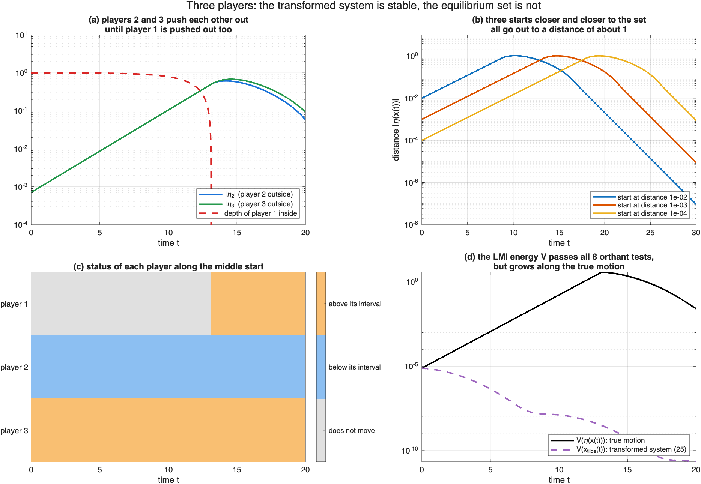
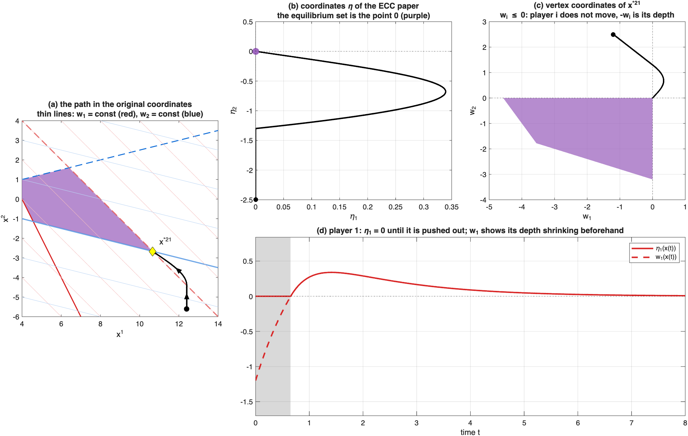
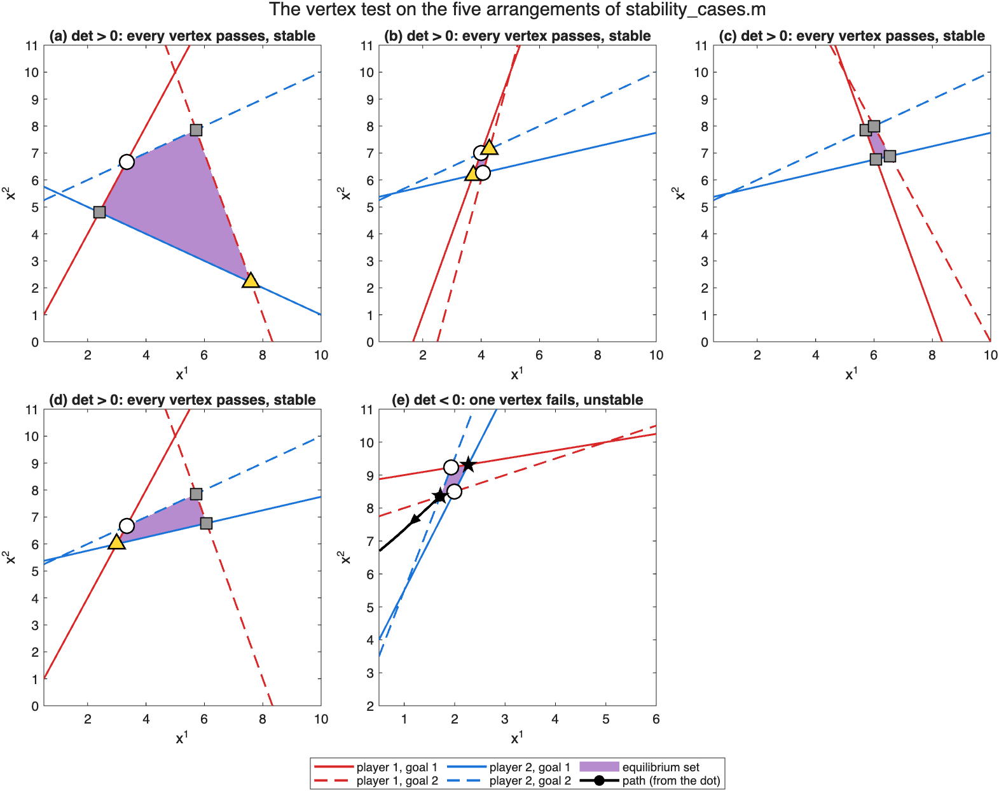

# Extension: stability of the equilibrium set for N players

> **Status.** The results in this folder are new and have **not yet been peer
> reviewed**. They were obtained by Zehui Guo and extend the published papers
> listed in [Section 1](#1-what-is-published-and-what-is-new). The co-authors
> of those papers have not yet reviewed this extension. The statements are
> given **without proofs**; a manuscript with the proofs is in preparation.
> The simulations illustrate the statements but do not prove them.

**In one paragraph.** In the main repository, two players adjust their
choices, and the published papers show when they settle down in the
equilibrium region. The proofs either check every arrangement of the four
best-response lines (IFAC 2023, CDC 2023) or change coordinates so that the
whole region becomes one point (ECC). This extension asks the same question
for **N players**. It shows that the coordinate change of the ECC paper is
not enough when N ≥ 3, introduces new coordinates that fix this, and reduces
the question to $`2^N`$ small systems, one at each corner of the region. For
these small systems it gives tests that do not depend on the players' speeds.
For two players the tests give back the determinant test of the main
repository.

1. [What is published and what is new](#1-what-is-published-and-what-is-new)
2. [The setting](#2-the-setting)
3. [Why the coordinate change is not enough for three players](#3-why-the-coordinate-change-is-not-enough-for-three-players)
4. [Vertex coordinates](#4-vertex-coordinates)
5. [Tests for one vertex](#5-tests-for-one-vertex)
6. [How to run](#6-how-to-run)
7. [References and how to cite](#7-references-and-how-to-cite)

---

## 1. What is published and what is new

| Topic | Published (script in the main repository) | New in this extension |
|---|---|---|
| Shape of the equilibrium set | Compact and connected; homeomorphic to a product of simplices under a rank condition [ACC 2024] (`equilibrium_three_players.m`) | For scalar states and two goals per player: a **convex polytope** whose $`2^N`$ corners are known in closed form; the rank condition can be **checked at the corners** |
| How the players move | Follow the goal whose best response is closer [IFAC 2023, CDC 2023] (`functions/pseudo_gradient.m`) | The same rule for N players (`functions/pseudo_gradient_n.m`) |
| Stability, two players | Determinant test, proved by checking five arrangements [IFAC 2023, CDC 2023] (`stability_cases.m`) | The same test **obtained from the new coordinates in one argument**; exponential stability; holds for **every choice of the speeds** |
| Coordinate change | $`\eta`$ maps the equilibrium set to the origin; stability of the transformed system implies stability of the set; LMI test [ECC] (`stability_lyapunov.m`) | For $`N \ge 3`$ the transformed system can be stable while the set is not (Section 3); **vertex coordinates** fix this (Section 4) |
| N players | – | **Localization theorem**, a sufficient and a necessary test, and when they coincide (Sections 4–5) |

**How the papers are cited below.** Equation and theorem numbers in brackets
refer to the ECC paper, which introduced the coordinate change:
the convention $`\mathcal X^*(J) = \mathcal D^1_{-1,1}\cap\mathcal D^2_{-1,1}`$ is its (8), the
dynamics are (9), the coordinate change $`\eta`$ is (20)–(21), the transformed
system is (25) with the matrices (27), and its main results are Theorem 1 and
Proposition 2. The determinant test is Theorem 3.10 of the thesis
[Guo 2025] and the main result of [IFAC 2023, CDC 2023]. The topology results
are Proposition 1, Lemma 2 and Theorem 3 of [ACC 2024].

---

## 2. The setting

**Players and goals.** There are $`N`$ players. Player $`i`$ chooses a number
$`x^i`$; the state is $`x = (x^1,\dots,x^N)`$. Player $`i`$ has two goals
$`J^i_1, J^i_2`$, each a quadratic function of $`x`$ that is strictly concave in
$`x^i`$, as in the main repository:

```math
J^i_j(x) = \tfrac12\, x^\top A^{ij} x + (b^{ij})^\top x + c^{ij}, \qquad A^{ij}_{ii} < 0 .
```

In the code a game is a struct `G` with `G.A{i,j}`, `G.b{i,j}` and
`G.alpha(i,j)` for any number of players.

**Signed distance to a best response.** If the other players' choices are
fixed, goal $`j`$ has one best choice $`\mathrm{BR}^i_j(x^{-i})`$ for player $`i`$.
The signed distance of player $`i`$ to it is

```math
d^i_j(x) \triangleq x^i - \mathrm{BR}^i_j(x^{-i}) = \frac{\mathrm{row}_i(A^{ij})\,x + b^{ij}_i}{A^{ij}_{ii}} = (r^{ij})^\top x + \beta^{ij},
```

an affine function of $`x`$ with $`r^{ij}_i = 1`$. The entry $`r^{ij}_k`$ ($`k \ne i`$)
says how the choice of player $`k`$ moves the best response of player $`i`$
(`functions/signed_distance.m`).

**Interval.** Between its two best responses, player $`i`$ cannot improve both
goals by moving; outside, it can. So the choices that player $`i`$ accepts form
an **interval** $`\mathcal P^i(x^{-i})`$ whose two ends are the best responses.
The ends **move when the other players move**.

**Equilibrium set.** $`x`$ is an equilibrium if every player is in its
interval: $`\mathcal X^*(J) = \{x : d^i_1(x)\,d^i_2(x) \le 0 \text{ for all } i\}`$.

**How the players move** (the rule of the main repository, for N players).
A player inside its interval does not move; we call it **inactive**. Otherwise
it is **active** and moves toward the closer end of its interval:

```math
\dot x^i = -\kappa^i_j\, d^i_j(x), \qquad \kappa^i_j = -\alpha^i_j A^{ij}_{ii} > 0,
```

where $`j`$ is the goal whose best response is closer and $`\alpha^i_j > 0`$ is
the **sensitivity parameter** (the speed) of the papers. An inactive player
does not move, but its interval moves whenever active players move. All new
phenomena for $`N \ge 3`$ come from this fact.

**Corners.** A *selection* $`\sigma = (j^1,\dots,j^N)`$ picks one goal for each
player. Its **vertex point** $`x^{*\sigma}`$ is the point where every player is
exactly at the best response of its selected goal, i.e. $`d^i_{j^i}(x^{*\sigma}) = 0`$
for all $`i`$. Write $`R^\sigma`$ for the matrix with rows $`(r^{ij^i})^\top`$ and
$`\beta^\sigma`$ for the vector of the $`\beta^{ij^i}`$, so $`x^{*\sigma} = -(R^\sigma)^{-1}\beta^\sigma`$
(`functions/vertex_data.m`).

**Assumptions** (the conditions of [ACC 2024] for scalar states and two
goals):
- **A1.** The $`2^N`$ determinants $`\det R^\sigma`$ are nonzero and have the same sign.
- **A2.** At no equilibrium do the two best responses of a player coincide
  (the rank condition of [ACC 2024]).

Under A2, goal 1 can be numbered so that it gives the **lower** end of every
interval near the equilibrium set (`functions/orient_payoffs.m`), as in (8).

**Result 1 (shape of the equilibrium set).** Under A1 and A2, the
equilibrium set is the **convex polytope**

```math
\mathcal X^*(J) = \{x : d^i_2(x) \le 0 \le d^i_1(x) \text{ for all } i\} = \mathrm{conv}\{x^{*\sigma}\},
```

whose corners are exactly the $`2^N`$ vertex points. Moreover, A2 holds if and
only if, for every player, the width $`d^i_1 - d^i_2`$ of its interval has one
sign at all $`2^N`$ vertex points. This gives a finite test for the rank
condition and adds convexity to the topology of [ACC 2024]. (Convexity uses
that each state is a number and each player has two goals; with vector states
the faces need not be flat, see Example 3 of [ACC 2024].)

---

## 3. Why the coordinate change is not enough for three players

The coordinate change of the ECC paper sets $`\eta_i(x)`$ to the signed
distance of player $`i`$ to the end it moves toward, and $`\eta_i(x) = 0`$ if
player $`i`$ is inactive (20). The equilibrium set becomes the origin. While
all players are active, $`\eta`$ follows a linear system in each orthant (25);
Theorem 1 of the ECC paper says that stability of the origin of this
transformed system implies stability of the equilibrium set.

For two players this works because when one player is inactive, the other
moves toward a best response that depends only on the inactive player, which
does not move. For three players, if player 1 is inactive, players 2 and 3
still move each other's intervals. Their motion is governed by a $`2\times2`$
part of the matrix of (25), and that part can be unstable even if the whole
matrix is stable.

**Example (`face_counterexample_3d.m`).** Three players with

```math
J^i_1(x) = -\tfrac12\big((Rx)_i + 1\big)^2,\quad J^i_2(x) = -\tfrac12\big((Rx)_i - 1\big)^2,\qquad
R = \begin{bmatrix} 1 & 1 & 0\\ -1 & 1 & 1.5\\ 0.5 & 1.5 & 1\end{bmatrix},
```

and all speeds equal to one. Every interval has width 2, and A1, A2 hold.
The transformed system (25) is $`\dot{\tilde x} = -R\tilde x`$ in all eight
orthants, and $`-R`$ is stable, so the LMI test of Proposition 2 passes.
But with player 1 inactive, players 2 and 3 follow
$`-\left[\begin{smallmatrix}1 & 1.5\\ 1.5 & 1\end{smallmatrix}\right]`$, which has
the eigenvalue $`+0.5`$: each one's correction pushes the other further out.



- **(a)** One start with player 1 inside its interval. The distances of
  players 2 and 3 grow, while the depth of player 1 inside its interval
  shrinks (its interval moves). When the depth reaches zero, player 1 is
  pushed out too.
- **(b)** Starts at distance $`10^{-2}, 10^{-3}, 10^{-4}`$ from the set all go
  out to a distance of about 1 before coming back. Starting closer does not
  keep the path closer, so the set is **not stable**.
- **(c)** What each player does along the start of (a).
- **(d)** The energy $`V`$ that passes all eight orthant tests of
  Proposition 2 decreases along the transformed system (dashed) but grows
  along the true motion (solid).

---

## 4. Vertex coordinates

**What $`\eta`$ loses.** For an inactive player, $`\eta_i = 0`$ whether the player
is just inside its interval or deep inside. But how deep it is decides whether
the moving interval will push it out. Near a vertex point every player is
close to its selected end, so we measure every player from that end and keep
the sign.

**Definition.** For a selection $`\sigma`$ let $`s_i = -1`$ if the selected end of
player $`i`$ is its lower end and $`s_i = +1`$ if it is the upper end, and
$`E^\sigma = \mathrm{diag}(s_1,\dots,s_N)`$. The **vertex coordinates** are

```math
w = E^\sigma\big(R^\sigma x + \beta^\sigma\big), \qquad w_i = s_i\, d^i_{j^i}(x).
```

This is the affine formula (21) of the ECC paper for the region where all
players are active, multiplied by $`E^\sigma`$ and used **everywhere**, instead
of switching to $`\eta_i = 0`$ for inactive players. In the **side region**
$`U^\sigma`$, where no player is beyond the opposite end of its interval:
- $`w_i > 0`$: player $`i`$ is active, and $`w_i`$ is its distance outside;
- $`w_i \le 0`$: player $`i`$ is inactive, and $`-w_i`$ is its **depth** inside.

**The vertex model.** In $`U^\sigma`$ the motion in vertex coordinates is
exactly

```math
\dot w = B^\sigma\,[w]_+, \qquad B^\sigma = E^\sigma \tilde A^\sigma E^\sigma = -E^\sigma R^\sigma K^\sigma E^\sigma,
```

where $`[w]_+`$ keeps the positive entries of $`w`$ and sets the others to 0,
$`\tilde A^\sigma`$ is the matrix (27), and $`K^\sigma = \mathrm{diag}(\kappa^i_{j^i})`$.
Only active players move, but the coordinates of inactive players change
too: their depth shrinks or grows as the others move.



The game is the example of the ECC paper (`stability_lyapunov.m`); the path
starts near the vertex point $`x^{*21}`$ with player 1 inside its interval.
- **(a)** The path in the original coordinates. The thin lines are the
  levels of $`w_1`$ (red) and $`w_2`$ (blue).
- **(b)** In the coordinates $`\eta`$, the path starts on the axis
  $`\eta_1 = 0`$: nothing shows that player 1 is about to be pushed out.
- **(c)** In vertex coordinates the start has $`w_1 = -1.2`$ (depth 1.2), and
  the path moves to $`w_1 > 0`$ before turning back into the image of the
  equilibrium set (purple).
- **(d)** Player 1 over time: $`\eta_1 = 0`$ while it is inactive (grey), but
  $`w_1`$ shows the depth shrinking until it is pushed out.

**Theorem 1 (localization).** Under A1 and A2, the equilibrium set is
locally exponentially stable if and only if each of the $`2^N`$ vertex models
$`\dot w = B^\sigma [w]_+`$ is exponentially stable.

So stability of the set is decided by $`2^N`$ separate small systems, one at
each corner. For two players this replaces the case-by-case analysis of the
regions around the set.

---

## 5. Tests for one vertex

**Outward and inward coupling.** The off-diagonal entry $`B^\sigma_{ik}`$ tells
how the correction of player $`k`$ changes $`w_i`$, through the move of player
$`i`$'s selected end. If $`B^\sigma_{ik} > 0`$, it pushes player $`i`$ outward
(further outside, or less deep inside): an **outward coupling**. If
$`B^\sigma_{ik} < 0`$, it is an **inward coupling**. The **outward coupling
matrix** $`C^\sigma`$ keeps only the outward couplings, without the speeds:
$`C^\sigma_{ik} = \max\{-s_i s_k r^{ij^i}_k,\, 0\}`$ for $`i \ne k`$, and
$`C^\sigma_{ii} = 0`$. Write $`\rho`$ for the spectral radius.

**Theorem 2 (sufficient, any speeds).** If $`\rho(C^\sigma) < 1`$, the vertex
model of $`\sigma`$ is exponentially stable for every choice of the sensitivity
parameters. A Lyapunov function is $`V(w) = p^\top [w]_+`$ with any $`p > 0`$
such that $`p^\top (I - C^\sigma) > 0`$.

**Corollary.** If $`\rho(\bar C) < 1`$, where $`\bar C_{ik} = \max_j |r^{ij}_k|`$,
the equilibrium set is locally exponentially stable for every choice of the
sensitivity parameters. Moreover, $`V(x) = \sum_i p_i |\eta_i(x)|`$ with
$`p = (I - \bar C)^{-\top}\mathbf 1`$ decreases along all solutions, and a
region of attraction is obtained from $`N`$ linear programs.

**Theorem 3 (necessary, any speeds).** Suppose that for some group $`S`$ of at
least two players all couplings within $`S`$ at $`\sigma`$ are outward, and let
$`\lambda`$ be the largest eigenvalue of $`B^\sigma_{SS}`$. If $`\lambda > 0`$, the
equilibrium set is **not stable**, for every choice of the sensitivity
parameters. (If $`\lambda = 0`$, it is not exponentially stable.)

**Theorem 4 (when the tests coincide).** If, within every group of players
that push each other outward (every strongly connected component of the graph
of $`C^\sigma`$), no coupling is inward, then the vertex model is exponentially
stable **if and only if** $`\rho(C^\sigma) < 1`$.

**Theorem 5 (two players).** For two players the condition of Theorem 4
always holds, so

```math
\mathcal X^*(J) \text{ is locally exponentially stable for every choice of the speeds} \iff \det R^\sigma > 0,
```

and if $`\det R^\sigma < 0`$ the set is not stable for any speeds. Since
$`\det R^\sigma`$ has the sign of the determinants of `stability_cases.m`, this
is the determinant test of [IFAC 2023, CDC 2023], obtained from one argument.
It also shows that the LMI test of Proposition 2 of the ECC paper is
sufficient but not necessary: the LMI is posed for one choice of the speeds
and for the transformed system (25), which continues into the next quadrant
where the true motion stays on an axis.



The five arrangements of `stability_one_piece.png` in the main repository.
Each vertex point is marked by the kind of its two couplings. Instability
can only come from a vertex where both couplings are outward (black star).
In (e) the determinants are negative, and a path that starts next to such a
vertex, along the direction in which the two players push each other out,
moves away. In (a)–(d) every vertex passes the test, as predicted by the
positive determinants.

**Open questions.** An exact test when outward and inward couplings are mixed
within one group of players (Theorems 2 and 3 leave a gap there); whether
every vertex model with a P-matrix $`R^\sigma`$ is stable; larger regions of
attraction; vector states and more than two goals per player.

---

## 6. How to run

Open MATLAB in this folder and type `run_n_agent_stability` (about one
minute; no toolboxes needed). The helpers of the main repository in
`../../functions/` are added to the path and used unchanged.

| Script | What it shows | Figure |
|---|---|---|
| `vertex_coordinates_2d.m` | Two players: vertex coordinates on the ECC example; the vertex test on the five arrangements of `stability_cases.m` | `vertex_coordinates.png`, `vertex_test_2d.png` |
| `face_counterexample_3d.m` | Three players: the transformed system is stable, the equilibrium set is not | `face_counterexample_3d.png` |

Each script prints `[PASS]` / `[FAIL]` lines; all 22 checks should pass.
The helpers of this extension are in [`functions/`](functions/):
`signed_distance`, `pseudo_gradient_n`, `eta_n`, `vertex_data`,
`orient_payoffs`, `simulate_n`, `save_extension_figure`.

---

## 7. References and how to cite

Published work this extension builds on:

- **[ACC 2024]** Z. Guo, T. Hayakawa, "Topology of Nash equilibrium set with quadratic vector payoff functions," *American Control Conference*, 2024. [doi:10.23919/ACC60939.2024.10644643](https://doi.org/10.23919/ACC60939.2024.10644643)
- **[IFAC 2023]** Z. Guo, T. Hayakawa, Y. Yan, "Nash equilibrium of 2-agent game with quadratic vector payoff functions and its stability," *IFAC World Congress*, 2023. [doi:10.1016/j.ifacol.2023.10.1395](https://doi.org/10.1016/j.ifacol.2023.10.1395)
- **[CDC 2023]** Z. Guo, T. Hayakawa, Y. Yan, "Stability and stabilization of Nash equilibrium for noncooperative systems with vector-valued payoff functions," *IEEE Conference on Decision and Control*, 2023. [doi:10.1109/CDC49753.2023.10384265](https://doi.org/10.1109/CDC49753.2023.10384265)
- **[ECC]** Z. Guo, T. Hayakawa, "A coordinate transformation method for stability analysis of Nash equilibria with vector payoff functions," *European Control Conference*.
- **[Guo 2025]** Z. Guo, "Stability and incentive design for noncooperative dynamical systems with vector-valued payoff functions," Ph.D. dissertation, Institute of Science Tokyo, 2025.

The results of Sections 2 (Result 1), 3, 4 and 5 are new and not yet
published. Until the manuscript appears, please cite this repository and the
papers above.
